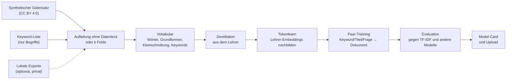

# m2v-training

**Kleine, schnelle Embedding-Modelle für deutsche Bildungsinhalte, aus einem großen Transformer trainiert und
ehrlich evaluiert.**

*English version: [README.md](README.md)*

## Was dieses Repository macht

Es trainiert [Model2Vec](https://github.com/MinishLab/model2vec)-Modelle: statische Embedding-Modelle, die einen
Text in einen Vektor verwandeln, indem sie für jedes Token einen Vektor nachschlagen und mitteln. Ein solches
Modell braucht beim Einsatz weder GPU noch Transformer und ist auf der CPU um Größenordnungen schneller als ein
Transformer. Es passt deshalb dorthin, wo ein Transformer nicht passt: Suche während des Tippens,
Stapelverarbeitung von Hunderttausenden Datensätzen, kleine Server ohne GPU.

Die Modelle hier sind auf **deutsche Lernmaterialien** zugeschnitten (Arbeitsblätter, Videos, Kurse,
OER-Metadaten): Materialien zu einem Schlagwort oder einer Frage finden, einen Titel seiner Beschreibung zuordnen
und das Schulfach erkennen. Dabei kommt es auf Substantive und Fachbegriffe an („Bruchrechnung“,
„Photosynthese“, „Zellatmung“), mit denen allgemeine statische Modelle schlecht umgehen.

Das Repository enthält die ganze Kette von den Daten bis zum veröffentlichten Modell:



Jeder Schritt ist in [docs/de/funktionsweise.md](docs/de/funktionsweise.md) erklärt.

## Prinzipien

1. **Transformer-Qualität beim Training, Nachschlage-Tempo beim Einsatz.** Ein starker, frei lizenzierter
   Transformer (der *Lehrer*) wird nur beim Training gebraucht. Sein Wissen wird in das statische Modell
   destilliert und danach verfeinert: Die Token-Vektoren lernen, die Satz-Embeddings des Lehrers nachzubilden
   (Tokenlearn) und zusammengehörige Texte zusammenzubringen (Paar-Training).
2. **Gebaut für die Art, wie Menschen suchen.** Gesucht wird mit einzelnen Substantiven, kleingeschrieben,
   gebeugt („brüche“, „Zellen“). Das Vokabular enthält deshalb neben den Teilwort-Tokens des Lehrers ganze Wörter,
   ihre Grundformen und Kleinschreibvarianten, und das Training mischt Rohtext mit Grundform-Text. So funktioniert
   dasselbe Modell mit Rohtext und mit lemmatisierter Eingabe. Warum, steht in den
   [Erfahrungen](docs/de/erfahrungen.md).
3. **Eine Datenbasis, die sich dokumentieren lässt.** Das Training braucht nichts, was sich nicht veröffentlichen
   ließe: einen frei lizenzierten synthetischen Datensatz und eine reine Liste von Fachbegriffen. Private Exporte
   gehen für Experimente, kommen aber nie ins Repository, und Model Cards beschreiben sie nur auf ausdrücklichen
   Wunsch. [Datenbasis und Lizenzen](docs/de/daten-und-lizenzen.md).
4. **Ehrliche Evaluation.** Beinahe-Dubletten und Datensätze zum selben Thema landen nie auf beiden Seiten einer
   Aufteilung. Die k-Fold-Kreuzvalidierung nutzt alle Daten zum Training und testet trotzdem jedes Modell auf Daten,
   die es nie gesehen hat; Ergebnisse sind Mittelwert ± Standardabweichung. Jeder Lauf wird mit TF-IDF und anderen
   Modellen verglichen, mit Rohtext und mit Grundformen, und verglichen werden nur Läufe mit gleichem
   Split-Fingerabdruck. [Evaluation](docs/de/evaluierung.md).
5. **Nur freie Lizenzen.** Lehrer und Daten stehen unter Apache 2.0, MIT oder CC BY; nicht-kommerzielle Modelle
   werden nicht genutzt. Die Model Card trägt die passende Lizenz und die Namensnennung, die die Daten verlangen.
   [Lehrermodelle](docs/de/lehrermodelle.md).
6. **Reproduzierbar und fortsetzbar.** Jeder Lauf speichert seine vollständige Konfiguration;
   `run runs/<lauf>/config.json` wiederholt ihn. Seeds legen Aufteilung und Stichproben fest. Die
   Lehrer-Embeddings werden blockweise gespeichert, ein unterbrochener Lauf macht dort weiter, wo er aufgehört hat.
7. **Läuft auf der vorhandenen Hardware.** Dieselben Konfigurationen laufen auf einem Laptop ohne GPU, mit einer
   GPU oder auf einem PC mit zwei GPUs, der von einem anderen Rechner gesteuert wird. Lange Läufe starten
   abgekoppelt; das Schließen eines Terminals beendet sie nicht.

## Stand

Der Vorgänger dieses Setups hat
[`JanSchachtschabel/m2v-gte-256-edu-v2`](https://huggingface.co/JanSchachtschabel/m2v-gte-256-edu-v2) erzeugt
(Lehrer gte-multilingual-base, 256 Dimensionen, ohne GPU trainiert). Auf seinem eigenen Testteil hoben Tokenlearn
und Paar-Training die Keyword-Suche (nDCG@10) gegenüber reiner Destillation von 0,084 auf 0,323, und das Modell
schlug TF-IDF und potion-multilingual-128M. Als Nächstes: ein stärkerer Lehrer auf der GPU (Qwen3-Embedding-4B,
bge-m3 und gte im Vergleich per 3-Fold-Kreuzvalidierung) auf der dokumentierbaren Datenbasis, danach ein finaler
5-Fold-Lauf.

## Einstieg

```bash
git clone https://github.com/janschachtschabel/m2v-training
cd m2v-training
./scripts/setup_linux.sh            # Windows: .\scripts\setup_windows.ps1  (installiert PyTorch für CUDA 12.8+)
source .venv/bin/activate           # Windows: .venv\Scripts\Activate.ps1

# optional, aber empfohlen: Keyword-Liste (nur Begriffe) aus einem lokalen Metadaten-Export
python -m m2vtrain extract-keywords pfad/zum/export.csv.gz data/keywords.txt --min-docs 3

# wenige Minuten auf der CPU: prüft die ganze Kette von Anfang bis Ende
python -m m2vtrain run configs/smoke-test-cpu.json
```

Danach den Weg wählen, der zur Hardware passt:

| Hardware | Was starten | Anleitung |
|---|---|---|
| nur CPU | `configs/smoke-test-cpu.json` oder eine eigene Konfiguration mit dem Standard-Lehrer (ein voller Lauf dauert fast einen Tag) | [Konfiguration](docs/de/konfiguration.md) |
| eine GPU mit 16 GB (z. B. RTX 5060 Ti) | Lehrervergleich `configs/rtx5060ti-0*.json`, dann `configs/rtx5060ti-final-5fold.json` | [GPU-Einrichtung](docs/de/gpu-einrichtung.md) |
| zwei GPUs, per SSH gesteuert | `scripts/remote.sh start-compare`, dann `start-final` | [Zwei GPUs](docs/de/zwei-gpus.md) |

Die Streamlit-Oberfläche macht dasselbe mit Formularen: `streamlit run ui/app.py` (nur auf dem eigenen Rechner
erreichbar).

## Ein trainiertes Modell nutzen

```python
from model2vec import StaticModel

model = StaticModel.from_pretrained("JanSchachtschabel/m2v-gte-256-edu-v2")
embeddings = model.encode(["Bruchrechnung für die 6. Klasse", "Photosynthese"])
```

Für kleingeschriebene Suchanfragen Anfragen und Dokumente vorher auf Substantiv-Grundformen reduzieren:

```python
from m2vtrain.lemma import to_lemma_text
model.encode([to_lemma_text("die schülerinnen rechnen mit brüchen")])   # -> "Schülerin Bruch"
```

## Kommandozeile

```bash
python -m m2vtrain init-config meine.json --synthetic --keywords data/keywords.txt --folds 5
python -m m2vtrain run meine.json                   # Laufordner: runs/<Zeitstempel>-<Name>
python -m m2vtrain run runs/<lauf>/config.json      # einen Lauf mit gleichen Optionen wiederholen
python -m m2vtrain status                           # Zustand und Schritt der letzten Läufe
python -m m2vtrain stop [runs/<lauf>]               # einen oder alle laufenden Läufe beenden
python -m m2vtrain compare [runs/a runs/b] [--mode lemma]
python -m m2vtrain extract-keywords export.csv.gz data/keywords.txt [--min-docs 3] [--with-counts]
python -m m2vtrain upload models/<lauf> <user>/<modell> [--public]
```

Eine Konfiguration braucht nur `name`, eine Datenquelle und die Werte, die vom Standard abweichen; unbekannte
Schlüssel und falsche Typen werden abgelehnt. Alle Optionen: [docs/de/konfiguration.md](docs/de/konfiguration.md).

## Dokumentation

| Seite | Inhalt |
|---|---|
| [Funktionsweise](docs/de/funktionsweise.md) | jeder Schritt der Kette: was er tut, warum, und was ein Lauf schreibt |
| [Datenbasis und Lizenzen](docs/de/daten-und-lizenzen.md) | die Datenquellen, was nie ins Repository kommt, was vor einer Veröffentlichung zu prüfen ist |
| [Lehrermodelle](docs/de/lehrermodelle.md) | freie mehrsprachige Lehrer für 16 GB, Empfehlung, was nicht passt |
| [Evaluation und k-Fold](docs/de/evaluierung.md) | Kennzahlen, Aufteilung, Kreuzvalidierung, Läufe vergleichen, Grenzen der Zahlen |
| [GPU-Einrichtung](docs/de/gpu-einrichtung.md) | Installation für RTX 50xx, Laufzeiten, Speicher |
| [Zwei GPUs und Fernsteuerung](docs/de/zwei-gpus.md) | paralleler Lehrervergleich, finaler Lauf auf beiden Karten, Steuerung per SSH |
| [Konfiguration](docs/de/konfiguration.md) | alle Schlüssel und die fertigen Konfigurationen |
| [Erfahrungen](docs/de/erfahrungen.md) | was in bisherigen Läufen geholfen hat, Fallstricke, offene Ideen |

## Aufbau des Repositorys

```
m2vtrain/          Python-Paket (data, sources, split, vocab, targets, train, evaluate, pipeline, export, cli)
ui/                Streamlit-Oberfläche
configs/           fertige Laufkonfigurationen (CPU-Schnelltest, Lehrervergleich RTX 5060 Ti, finale Läufe, dual-gpu/)
scripts/           Einrichtung (Windows/Linux), GPU-Check, abgekoppelte Läufe, Warteschlangen, Steuerung per SSH
docs/en, docs/de   Dokumentation auf Englisch und Deutsch
tests/             Offline-Tests mit einem winzigen lokalen Lehrermodell (keine Downloads)
```

Zur Laufzeit entstehen die Ordner `data/`, `runs/`, `models/` und `cache/` im Ordner, aus dem gestartet wird (die
Oberfläche nutzt `M2V_HOME`, wenn gesetzt); git ignoriert sie.

## Tests

```bash
python -m pytest -q
```

Die Tests brauchen kein Internet; sie bauen ein winziges Zufalls-Lehrermodell und einen winzigen synthetischen
Datensatz lokal.

## Lizenz

Code: Apache 2.0 (siehe [LICENSE](LICENSE)). Trainierte Modelle übernehmen Pflichten von Lehrermodell und Daten:
`license` in der Konfiguration passend setzen (z. B. `apache-2.0` bei Apache-Lehrern, `mit` bei bge-m3) und die
Namensnennung des synthetischen Datensatzes (CC BY 4.0) beibehalten, die die erzeugte Model Card enthält.
