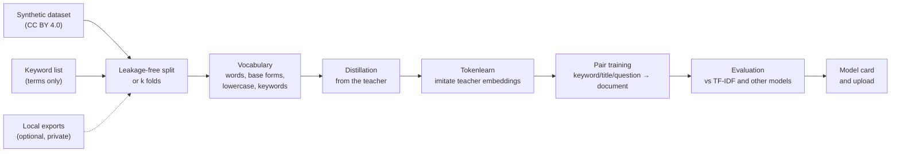

# m2v-training

**Small, fast embedding models for German educational content, trained from a large transformer and evaluated
honestly.**

*Deutsche Fassung: [README.de.md](README.de.md)*

## What this repository does

It trains [Model2Vec](https://github.com/MinishLab/model2vec) models: static embedding models that turn a text
into a vector by looking up one vector per token and averaging them. Such a model needs no GPU and no transformer
at inference time and is orders of magnitude faster than a transformer on a CPU, so it fits where a transformer
does not: search-as-you-type, batch jobs over hundreds of thousands of records, small servers without a GPU.

The models here are tuned for **German learning materials** (worksheets, videos, courses, OER metadata): finding
materials for a keyword or question, matching a title to its description, and recognising the school subject.
These tasks hinge on nouns and subject terms ("Bruchrechnung", "Photosynthese", "Zellatmung"), which generic
static models handle poorly.

The repository contains the complete pipeline, from data to a published model:



Each step is explained in [docs/en/how-it-works.md](docs/en/how-it-works.md).

## Principles

1. **Transformer quality at training time, lookup speed at use.** A strong, freely licensed transformer (the
   *teacher*) is used only during training. Its knowledge is distilled into the static model and then refined by
   training the token vectors to reproduce the teacher's sentence embeddings (tokenlearn) and to match related
   texts (pair training).
2. **Built for how people search.** Users type single nouns, in lowercase, inflected ("brüche", "Zellen"). The
   vocabulary therefore holds whole words, their noun base forms and lowercase variants next to the teacher's
   subword tokens, and training mixes raw text with base-form text, so the same model works on raw text and on
   lemmatised input. See [lessons learned](docs/en/lessons-learned.md) for why.
3. **A data basis that can be documented.** Training needs nothing that cannot be published: an openly
   licensed synthetic dataset and a plain list of subject terms. Private exports can be used for experiments, but
   they never enter the repository, and model cards do not describe them unless asked to.
   [Data and licensing](docs/en/data-and-licensing.md).
4. **Honest evaluation.** Near-duplicates and records of the same topic never sit on both sides of a split.
   k-fold cross-validation uses all data for training and still tests every model on data it never saw; results
   are mean ± standard deviation. Every run is compared with TF-IDF and other models, on raw and on base-form
   input, and only runs with the same split fingerprint are compared. [Evaluation](docs/en/evaluation.md).
5. **Free licenses only.** Teachers and data are Apache 2.0, MIT or CC BY; non-commercial models are not used. The
   model card carries the right license and the attribution the data requires.
   [Teacher models](docs/en/teacher-models.md).
6. **Reproducible and resumable.** Every run stores its complete config; `run runs/<run>/config.json` repeats
   it. Seeds fix splits and samples. Teacher embeddings are cached in blocks, so an interrupted run continues
   where it stopped.
7. **Runs on the hardware at hand.** The same configs work on a CPU laptop, one GPU or a PC with two GPUs that is
   controlled from another computer. Long runs are started detached, so closing a terminal does not end them.

## Status

The predecessor of this setup produced
[`JanSchachtschabel/m2v-gte-256-edu-v2`](https://huggingface.co/JanSchachtschabel/m2v-gte-256-edu-v2) (teacher
gte-multilingual-base, 256 dimensions, trained on a CPU). On its own test set tokenlearn plus pair training raised
keyword search nDCG@10 from 0.084 to 0.323 compared with plain distillation, and the model beat TF-IDF and
potion-multilingual-128M. Next: a stronger teacher on a GPU (Qwen3-Embedding-4B, bge-m3 and gte compared by
3-fold cross-validation) on the documentable data basis, then a final 5-fold run.

## Getting started

```bash
git clone https://github.com/janschachtschabel/m2v-training
cd m2v-training
./scripts/setup_linux.sh            # Windows: .\scripts\setup_windows.ps1  (installs PyTorch for CUDA 12.8+)
source .venv/bin/activate           # Windows: .venv\Scripts\Activate.ps1

# optional but recommended: a keyword list (terms only) from a local metadata export
python -m m2vtrain extract-keywords path/to/export.csv.gz data/keywords.txt --min-docs 3

# a few minutes on a CPU: checks the whole pipeline end to end
python -m m2vtrain run configs/smoke-test-cpu.json
```

Then pick the path that matches your hardware:

| Hardware | What to run | Guide |
|---|---|---|
| CPU only | `configs/smoke-test-cpu.json`, or your own config with the default teacher (a full run takes most of a day) | [Configuration](docs/en/configuration.md) |
| One GPU with 16 GB (e.g. RTX 5060 Ti) | teacher comparison `configs/rtx5060ti-0*.json`, then `configs/rtx5060ti-final-5fold.json` | [GPU setup](docs/en/gpu-setup.md) |
| Two GPUs, controlled over SSH | `scripts/remote.sh start-compare`, then `start-final` | [Two GPUs](docs/en/dual-gpu.md) |

The Streamlit UI does the same with forms: `streamlit run ui/app.py` (German; listens on localhost only).

## Using a trained model

```python
from model2vec import StaticModel

model = StaticModel.from_pretrained("JanSchachtschabel/m2v-gte-256-edu-v2")
embeddings = model.encode(["Bruchrechnung für die 6. Klasse", "Photosynthese"])
```

For lowercase search queries, reduce queries and documents to noun base forms first:

```python
from m2vtrain.lemma import to_lemma_text
model.encode([to_lemma_text("die schülerinnen rechnen mit brüchen")])   # -> "Schülerin Bruch"
```

## Command line

```bash
python -m m2vtrain init-config my.json --synthetic --keywords data/keywords.txt --folds 5
python -m m2vtrain run my.json                      # run folder: runs/<timestamp>-<name>
python -m m2vtrain run runs/<run>/config.json       # repeat a run with the same options
python -m m2vtrain status                           # state and stage of the latest runs
python -m m2vtrain stop [runs/<run>]                # stop one or all running runs
python -m m2vtrain compare [runs/a runs/b] [--mode lemma]
python -m m2vtrain extract-keywords export.csv.gz data/keywords.txt [--min-docs 3] [--with-counts]
python -m m2vtrain upload models/<run> <user>/<model> [--public]
```

A config needs only `name`, a data source and the values that differ from the defaults; unknown keys and wrong
types are rejected. All options: [docs/en/configuration.md](docs/en/configuration.md).

## Documentation

| Page | Contents |
|---|---|
| [How it works](docs/en/how-it-works.md) | every pipeline step, what it does and why, and what a run writes |
| [Data and licensing](docs/en/data-and-licensing.md) | the data sources, what never goes into the repository, what to check before publishing |
| [Teacher models](docs/en/teacher-models.md) | free multilingual teachers for 16 GB, recommendation, what does not fit |
| [Evaluation and k-fold](docs/en/evaluation.md) | metrics, splits, cross-validation, comparing runs, limits of the numbers |
| [GPU setup](docs/en/gpu-setup.md) | installation for RTX 50xx, run times, memory |
| [Two GPUs and remote control](docs/en/dual-gpu.md) | parallel teacher comparison, final run on both cards, control over SSH |
| [Configuration](docs/en/configuration.md) | every config key and the ready-made configs |
| [Lessons learned](docs/en/lessons-learned.md) | what helped in earlier runs, pitfalls, ideas not yet tried |

## Repository layout

```
m2vtrain/          Python package (data, sources, split, vocab, targets, train, evaluate, pipeline, export, cli)
ui/                Streamlit UI (German)
configs/           ready-made run configs (CPU smoke test, RTX 5060 Ti teacher comparison, final runs, dual-gpu/)
scripts/           setup (Windows/Linux), GPU check, detached runs, run queues, control over SSH
docs/en, docs/de   documentation in English and German
tests/             offline tests with a tiny local teacher (no downloads)
```

At runtime the folders `data/`, `runs/`, `models/` and `cache/` are created in the folder you run from (the UI
uses `M2V_HOME` if it is set); git ignores them.

## Tests

```bash
python -m pytest -q
```

The tests need no internet; they build a tiny random teacher and a tiny synthetic dataset locally.

## License

Code: Apache 2.0 (see [LICENSE](LICENSE)). Trained models inherit obligations from their teacher and data: set
`license` in the config accordingly (for example `apache-2.0` for Apache teachers, `mit` for bge-m3) and keep the
CC BY 4.0 attribution of the synthetic dataset, which the generated model card includes.
